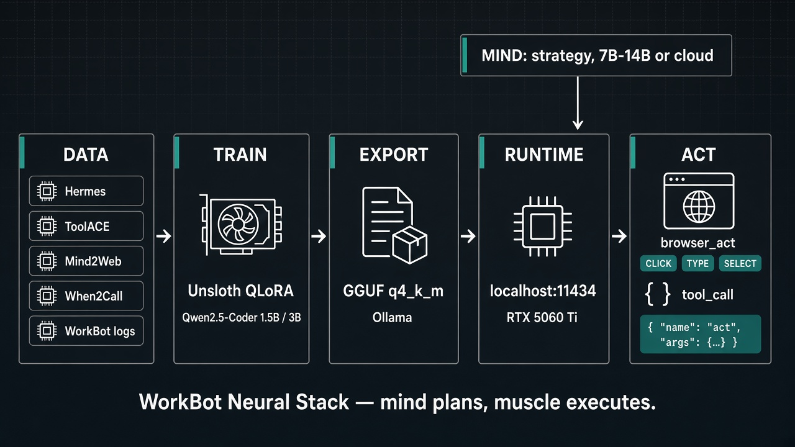

# The-Ai

## WorkBot Neural Stack

A local execution model you can train and run without paying Cursor, Claude, or OpenAI. A larger model plans. A fine-tuned 1.5B or 3B model does the repetitive work: tool calls and one browser action at a time.



The picture above is the whole system. Public tool-calling and browser datasets, plus your own successful WorkBot runs, go through a 4-bit LoRA fine-tune of Qwen2.5-Coder. The result is a small GGUF file served by Ollama on an RTX 5060 Ti (about 1 GB for 1.5B, about 2 GB for 3B at Q4_K_M). A Tauri/Rust layer sends fast steps to `localhost:11434`. When the small model has no tool to call, the step goes back up to the mind.

### Layers

| Layer | What it is | What it owns |
|---|---|---|
| Mind | A 7B–14B local model, or any cloud model you already use | Conversation, strategy changes, multi-step planning |
| Muscle | Qwen2.5-Coder 1.5B or 3B, LoRA-tuned in this notebook | One structured action per turn, no chat preamble |
| Train | [Unsloth](https://github.com/unslothai/unsloth) QLoRA, 4-bit NF4 | Overnight (or a free Colab T4) on your own machine |
| Export | GGUF `q4_k_m` + an Ollama `Modelfile` | Same prompt format the model was trained on |
| Runtime | Ollama at `127.0.0.1:11434` | Native `/api/chat` and an OpenAI-compatible `/v1` |
| Act | `browser_act` and `<tool_call>` JSON | `CLICK`, `TYPE`, or `SELECT` on an element id, or a named tool with arguments |

### What the muscle is allowed to say

The system prompt is short on purpose. If a provided tool can do the job, the model returns tool calls and nothing else. If a required argument is missing, it asks one short question. If no tool fits, it says so in one sentence so the mind can take the step.

A browser step looks like this on the way in:

```text
TASK: Check for pickup in Boston on March 18, 5pm, one guest
WEBSITE: exploretock
PREVIOUS ACTIONS:
1. [combobox] Reservation type -> SELECT: Pickup
ELEMENTS:
[6068] input type=search placeholder="Find a location"
[3622] div role=option "Boston"
```

and like this on the way out:

```xml
<tool_call>
{"name": "browser_act", "arguments": {"action": "CLICK", "element_id": "3622"}}
</tool_call>
```

That element list is the contract for the Rust side: strip the live DOM down to interactive nodes, print them in this shape, and execute the returned call.

### Train it

[](https://colab.research.google.com/github/AaronGrace978/The-Ai/blob/main/WorkBot_Micro_Specialist_Finetune.ipynb)

[`WorkBot_Micro_Specialist_Finetune.ipynb`](WorkBot_Micro_Specialist_Finetune.ipynb) does the full loop: load the open datasets, render them with Qwen's own chat template, score the base model, train on assistant turns only, score again, then write LoRA adapters, a GGUF, and a `Modelfile`.

Set the Colab runtime to a T4 GPU and run the cells from the top. Two presets:

| Preset | Base | Hardware |
|---|---|---|
| `colab_free` | Qwen2.5-Coder-1.5B-Instruct | Free Colab T4, about 1 to 1.5 hours of training |
| `quality` | Qwen2.5-Coder-3B-Instruct | Colab L4 or A100, or a local 16 GB GPU, overnight |

Training mix:

| Source | What it teaches |
|---|---|
| [Hermes function calling](https://huggingface.co/datasets/NousResearch/hermes-function-calling-v1) | Single calls, multi-turn tool use, schema-following JSON |
| [ToolACE](https://huggingface.co/datasets/Team-ACE/ToolACE) | A wide range of API schemas and nested arguments |
| [xLAM-60k](https://huggingface.co/datasets/Salesforce/xlam-function-calling-60k) | Verified function calls. Gated: accept the license and set `HF_TOKEN`, or the notebook skips it |
| [When2Call](https://huggingface.co/datasets/nvidia/When2Call) | Asking for a missing argument, or declining |
| [Mind2Web](https://huggingface.co/datasets/osunlp/Mind2Web) | Real browsing sessions, converted into `browser_act` steps. Train and eval are split by task |
| [Magicoder](https://huggingface.co/datasets/ise-uiuc/Magicoder-OSS-Instruct-75K) | A small coding slice so the coder base keeps that skill |
| Your JSONL | Successful WorkBot runs, repeated so they outweigh the public data |

The notebook prints before/after numbers on held-out data: whether it called a tool when it should, whether the JSON parses, whether the function name and arguments match, and whether the browser step picked the right element.

### Run it on the 5060 Ti

Unzip the export folder from the notebook and, from that folder:

```bash
ollama create workbot-muscle -f Modelfile
ollama run workbot-muscle "Commit my changes."
```

Anything that speaks the OpenAI API can point at `http://127.0.0.1:11434/v1` with the model name `workbot-muscle`. Ollama returns parsed `tool_calls`, so the Rust layer does not scrape text.

```rust
let body = serde_json::json!({
    "model": "workbot-muscle",
    "stream": false,
    "tools": [browser_act_tool],
    "messages": [{ "role": "user", "content": step_prompt }],
});
let resp: serde_json::Value = client
    .post("http://127.0.0.1:11434/api/chat")
    .json(&body).send().await?.json().await?;

match resp["message"]["tool_calls"].get(0) {
    Some(call) => execute_browser_act(&call["function"]["arguments"]).await?,
    None => escalate_to_mind(&resp["message"]["content"]).await?,
}
```

### Making the muscle yours

Log every step the stack takes: the prompt, the action, and whether it worked. Keep the successes, and especially the steps where the mind had to step in. Point `WORKBOT_DATA_PATH` at that JSONL and run the notebook again. A few hundred of your own workflows usually move the model more than another public dataset.

This specialist is for high-volume execution. Planning and large refactors stay with the mind.
